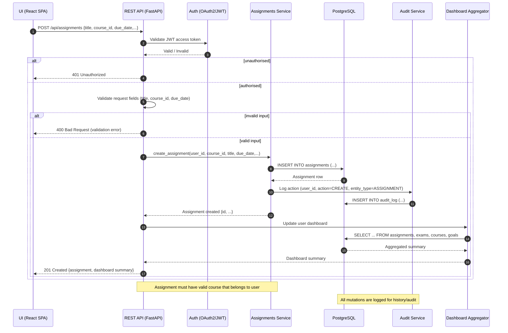

# University Study Planner

> Organize your academic life in one place!

A low-fidelity prototype of **University Study Planner**, generated by an agentic AI project manager from a stakeholder conversation in Slack.

## Screens

- [Home](index.html) — The landing page that introduces the planner and links to feature pages.
- [Add Courses](add_courses.html) — A page for students to input and view their courses.
- [Track Assignments](track_assignments.html) — A page for logging and tracking assignments and deadlines.
- [Track Exams](track_exams.html) — A page for recording exam dates and managing study plans.
- [Set Study Goals](set_study_goals.html) — A page for defining and tracking study goals.

## What this prototype fakes

- This prototype fakes the functionality of features and does not save data across sessions.
- The user can add courses, assignments, exams, and goals, but the data is not persistent.
- All forms reset after submission, and the new data appears in the UI immediately.

## System design

### Use Case Diagram: University Study Planner

This diagram expands on feature grouping and supporting uses, adding key supporting flows and organizing everything as the functional requirements demand. All main CRUD and listing operations for Courses, Assignments, Exams, and Study Goals are shown, but now include multi-edit, assignment submission status update, exam schedule view, and audit trail access. The dashboard's aggregate-screen function is central for 'organizing everything in one place.' Dotted edges clarify required includes (auth, validation, dashboard aggregates, and history accesses). Every actor and external dependency (like data storage or reminder mechanism) is explicit, making use case dependencies and actor interactions fully transparent.

```mermaid
flowchart LR
    student(("University Student"))
    subgraph System
      subgraph "Courses"
        addCourse["Add Course"]
        editCourse["Edit Course"]
        removeCourse["Remove Course"]
        listCourses["List Courses"]
        importCourses["Import Courses"]
        viewCourseHistory["View Course History"]
      end
      subgraph "Assignments"
        addAssignment["Add Assignment"]
        editAssignment["Edit Assignment"]
        removeAssignment["Remove Assignment"]
        listAssignments["List Assignments"]
        updateAssignmentStatus["Update Assignment Status"]
        multiEditAssignments["Bulk Edit Assignments"]
        viewAssignmentHistory["View Assignment History"]
      end
      subgraph "Exams"
        addExam["Add Exam"]
        editExam["Edit Exam"]
        removeExam["Remove Exam"]
        listExams["List Exams"]
        scheduleExamReview["Schedule Exam Review"]
        viewExamHistory["View Exam History"]
      end
      subgraph "Study Goals"
        setGoal["Set Study Goal"]
        editGoal["Edit Study Goal"]
        removeGoal["Remove Study Goal"]
        listGoals["List Study Goals"]
        markGoalComplete["Mark Goal as Complete"]
        viewGoalHistory["View Study Goal History"]
      end
      subgraph "Organizing/Dashboard"
        organizeDashboard["Organize Dashboard (show all)"]
        filterDashboard["Filter Dashboard View"]
      end
      subgraph "Core/Supporting"
        signIn["Sign in"]
        validateInput["Validate Input"]
        dataExport["Export Data"]
      end
    end
    student -- "" --> signIn
    student -- "" --> addCourse
    student -- "" --> editCourse
    student -- "" --> removeCourse
    student -- "" --> listCourses
    student -- "" --> importCourses
    student -- "" --> viewCourseHistory
    student -- "" --> addAssignment
    student -- "" --> editAssignment
    student -- "" --> removeAssignment
    student -- "" --> listAssignments
    student -- "" --> updateAssignmentStatus
    student -- "" --> multiEditAssignments
    student -- "" --> viewAssignmentHistory
    student -- "" --> addExam
    student -- "" --> editExam
    student -- "" --> removeExam
    student -- "" --> listExams
    student -- "" --> scheduleExamReview
    student -- "" --> viewExamHistory
    student -- "" --> setGoal
    student -- "" --> editGoal
    student -- "" --> removeGoal
    student -- "" --> listGoals
    student -- "" --> markGoalComplete
    student -- "" --> viewGoalHistory
    student -- "" --> organizeDashboard
    student -- "" --> filterDashboard
    student -- "" --> dataExport
    addCourse -. "include" .-> signIn
    addCourse -. "include" .-> validateInput
    addCourse -. "extend" .-> importCourses
    editCourse -. "include" .-> signIn
    editCourse -. "include" .-> validateInput
    removeCourse -. "include" .-> signIn
    removeCourse -. "include" .-> validateInput
    addAssignment -. "include" .-> signIn
    addAssignment -. "include" .-> validateInput
    editAssignment -. "include" .-> signIn
    editAssignment -. "include" .-> validateInput
    removeAssignment -. "include" .-> signIn
    removeAssignment -. "include" .-> validateInput
    updateAssignmentStatus -. "include" .-> signIn
    updateAssignmentStatus -. "include" .-> validateInput
    multiEditAssignments -. "include" .-> signIn
    multiEditAssignments -. "include" .-> validateInput
    addExam -. "include" .-> signIn
    addExam -. "include" .-> validateInput
    editExam -. "include" .-> signIn
    editExam -. "include" .-> validateInput
    removeExam -. "include" .-> signIn
    removeExam -. "include" .-> validateInput
    scheduleExamReview -. "include" .-> signIn
    setGoal -. "include" .-> signIn
    setGoal -. "include" .-> validateInput
    editGoal -. "include" .-> signIn
    editGoal -. "include" .-> validateInput
    removeGoal -. "include" .-> signIn
    removeGoal -. "include" .-> validateInput
    markGoalComplete -. "include" .-> signIn
    organizeDashboard -. "include" .-> signIn
    organizeDashboard -. "include" .-> listCourses
    organizeDashboard -. "include" .-> listAssignments
    organizeDashboard -. "include" .-> listExams
    organizeDashboard -. "include" .-> listGoals
    organizeDashboard -. "include" .-> filterDashboard
    organizeDashboard -. "extend" .-> dataExport
    viewCourseHistory -. "include" .-> signIn
    viewAssignmentHistory -. "include" .-> signIn
    viewExamHistory -. "include" .-> signIn
    viewGoalHistory -. "include" .-> signIn
    dataExport -. "include" .-> signIn
```

### Architecture Diagram: Study Planner System (Web)

The architectural diagram now includes explicit components for history/audit tracking, a separate Notification Scheduler for future study reminders, an Import/Export module for course data, and support for dashboard filtering. All major modules are represented—per feature area—with connections for background jobs (like review reminders). Edges are labeled with flow types (JSON, SQL, notifications, analytics events), cross-cutting infrastructure (logging, monitoring, etc.) and caching are shown. Dashboard Aggregator and audit/history services provide the basis for the full organizing and history capabilities described in the requirements.

```mermaid
flowchart TB
    subgraph client["Client"]
        webspa["React SPA"]
    end
    subgraph api["API / Backend"]
        apigw["API Gateway (FastAPI)"]
        auth["OAuth2/JWT Auth"]
        logging["Logging/Monitoring"]
        importer["Import/Export Service"]
    end
    subgraph domain["Domain Services"]
        svcCourses["Courses Service"]
        svcAssignments["Assignments Service"]
        svcExams["Exams Service"]
        svcGoals["Study Goals Service"]
        dashboard["Dashboard Aggregator"]
        audit["History/Audit Service"]
        filter["Dashboard Filtering"]
    end
    subgraph data["Data"]
        db1["PostgreSQL"]
        redis1["Redis Cache"]
    end
    subgraph ext["External Services"]
        emailProvider["Email Provider (Future)"]
        bgtasks["Task Scheduler/Worker"]
        notifier["Notification Scheduler"]
    end
    webspa -->|"HTTPS / JSON"| apigw
    apigw -->|"Validate JWT"| auth
    apigw -->|"Log / metrics"| logging
    apigw -->|"Import/export requests"| importer
    apigw -->|"Call service"| svcCourses
    apigw -->|"Call service"| svcAssignments
    apigw -->|"Call service"| svcExams
    apigw -->|"Call service"| svcGoals
    apigw -->|"Call service"| dashboard
    apigw -->|"History/audit events"| audit
    apigw -->|"Call service"| filter
    svcCourses -->|"SQL"| db1
    svcAssignments -->|"SQL"| db1
    svcExams -->|"SQL"| db1
    svcGoals -->|"SQL"| db1
    dashboard -->|"SQL + aggregate"| db1
    audit -->|"SQL (audit tables)"| db1
    importer -->|"Bulk SQL"| db1
    svcCourses -->|"Cache course list"| redis1
    svcAssignments -->|"Cache assignment list"| redis1
    dashboard -->|"Cache dashboard"| redis1
    dashboard -- "Aggregate requests" --> svcCourses
    dashboard -- "Aggregate requests" --> svcAssignments
    dashboard -- "Aggregate requests" --> svcExams
    dashboard -- "Aggregate requests" --> svcGoals
    dashboard -->|"Enqueue reminder job"| bgtasks
    bgtasks -->|"Notify user"| notifier
    bgtasks -->|"Send mail (future)"| emailProvider
    logging -- "Log DB ops" --> db1
    audit -- "Emit analytics" --> logging
    importer -- "Log import/export" --> logging
```



### Entity Relationship Diagram: Study Planner Data Model

This ERD expands the data model adding AUDIT_LOG (for entity change history), DASHBOARD_VIEW (for user dashboard/filter preferences), and COURSE_IMPORT_LOG (to audit bulk imports). Each entity includes necessary and domain-driven fields: assignments and exams are linked to both courses and users; audit tables log changes; study goals are linked optionally to courses. Many-to-many and one-to-many relationships are explicit, with clear verb labels. History, filtering, and organizing features now map directly onto specific persistent entities, making system requirements fully realizable.

```mermaid
erDiagram
    UNIVERSITY_USER {
      uuid id PK
      string email UK
      string password_hash
      string full_name
      datetime created_at
      datetime updated_at
    }
    COURSE {
      uuid id PK
      uuid user_id FK
      string name
      string code
      string semester
      datetime created_at
      datetime updated_at
    }
    ASSIGNMENT {
      uuid id PK
      uuid user_id FK
      uuid course_id FK
      string title
      text description
      date due_date
      string status
      datetime created_at
      datetime updated_at
    }
    EXAM {
      uuid id PK
      uuid user_id FK
      uuid course_id FK
      string title
      date exam_date
      text description
      string location
      datetime created_at
      datetime updated_at
    }
    STUDY_GOAL {
      uuid id PK
      uuid user_id FK
      uuid course_id FK NULLABLE
      string title
      text description
      date due_date
      boolean completed
      datetime created_at
      datetime updated_at
    }
    AUDIT_LOG {
      uuid id PK
      uuid user_id FK
      string entity_type
      uuid entity_id
      string action
      json change_data
      datetime timestamp
    }
    DASHBOARD_VIEW {
      uuid id PK
      uuid user_id FK
      json filters
      string layout
      datetime last_accessed
    }
    COURSE_IMPORT_LOG {
      uuid id PK
      uuid user_id FK
      int imported_courses
      datetime imported_at
    }
    UNIVERSITY_USER ||--o{ COURSE : "enrolls in"
    UNIVERSITY_USER ||--o{ ASSIGNMENT : "has"
    UNIVERSITY_USER ||--o{ EXAM : "has"
    UNIVERSITY_USER ||--o{ STUDY_GOAL : "sets"
    UNIVERSITY_USER ||--o{ AUDIT_LOG : "triggers"
    UNIVERSITY_USER ||--o{ DASHBOARD_VIEW : "views"
    UNIVERSITY_USER ||--o{ COURSE_IMPORT_LOG : "imports"
    COURSE ||--o{ ASSIGNMENT : "assigns"
    COURSE ||--o{ EXAM : "includes"
    COURSE ||--o{ STUDY_GOAL : "relates to"
    ASSIGNMENT ||--o{ AUDIT_LOG : "is logged in"
    EXAM ||--o{ AUDIT_LOG : "is logged in"
    COURSE ||--o{ AUDIT_LOG : "is logged in"
    STUDY_GOAL ||--o{ AUDIT_LOG : "is logged in"
```

### Sequence Diagram: Student Adds an Assignment, with Dashboard Update and History Logging

Tracing the complete add-assignment flow, the diagram now includes Auditing (logging the change), Dashboard Aggregation (updating the UI summary), and error/alt paths for input and downstream failures. The UI makes a POST, the backend authenticates JWT, validates, checks course ownership, and passes the request to the Assignment Service. The service writes the assignment to the DB, emits an audit event, and signals the Dashboard to recompute summaries. Errors for unauthorized, invalid data, or DB failures are explicit, and a successful create also responds with updated dashboard data. Notes highlight key business logic: validation, authorization, audit logging, and dashboard sync.



## Running it

Every file is static. Open `index.html`, or serve the directory with any static file server.
